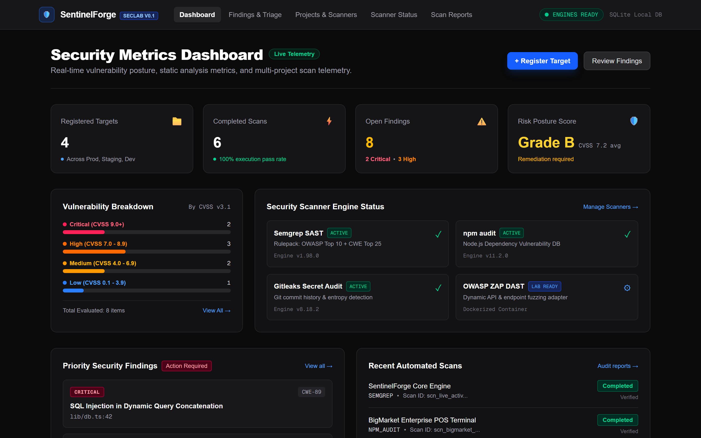
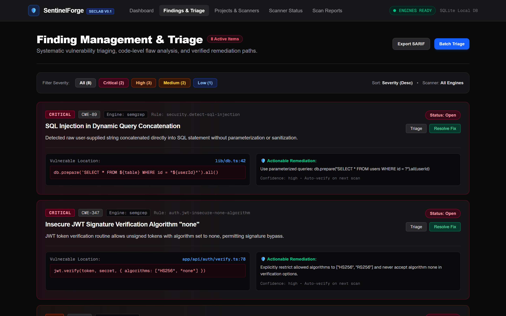
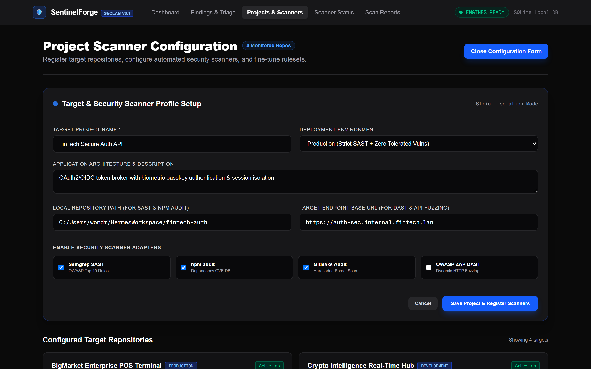
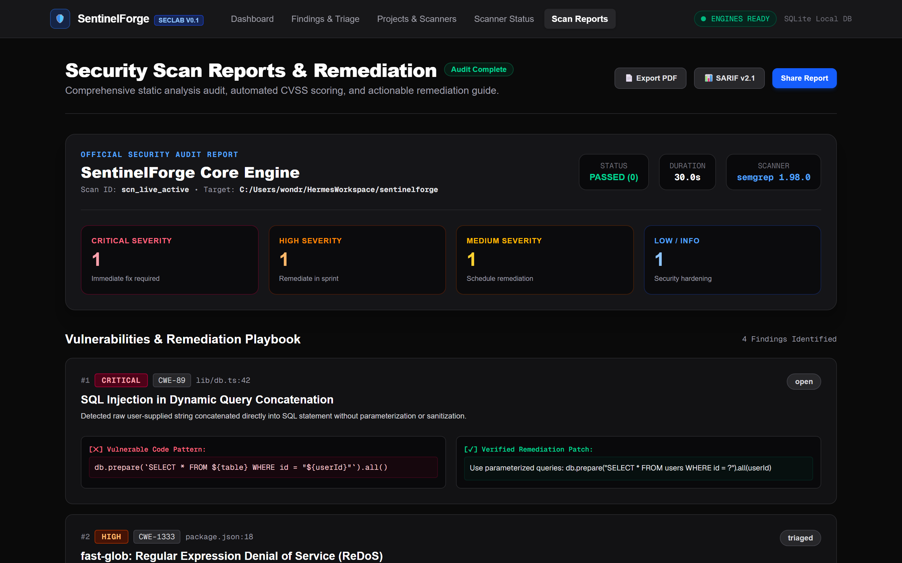

# SentinelForge

Open-Source Application Security Lab

Repository: https://github.com/0xyz-exe/sentinelforge

## Screenshots

### 1. Security Metrics Dashboard
Tampilan dashboard telemetri keamanan sentral menyajikan ringkasan metrik postur kerentanan multi-proyek secara real-time, mencakup total target yang terdaftar lintas lingkungan (Production, Staging, Development), rasio penyelesaian pemindaian (100% pass rate), penghitung temuan aktif yang diklasifikasikan berdasarkan standar CVSS v3.1 (Critical, High, Medium, Low), serta status kesiapan engine scanner inti seperti Semgrep SAST, npm audit, Gitleaks, dan OWASP ZAP container lab.



### 2. Finding Management & Triage
Antarmuka triase dan penelusuran kerentanan mendalam menampilkan katalog temuan keamanan lengkap dengan badge keparahan berkode warna, klasifikasi kelemahan CWE (seperti CWE-89 SQL Injection dan CWE-347 JWT algorithm none), jalur file serta nomor baris yang terdampak, cuplikan kode bukti kerentanan (*evidence snippet*), rekomendasi remediasi kode yang dapat langsung diterapkan (*actionable remediation*), serta tombol aksi penyesuaian status investigasi.



### 3. Project Scanner Configuration
Formulir konfigurasi profil proyek dan scanner terintegrasi memfasilitasi pendaftaran target aplikasi baru dengan validasi ketat isolasi lokal, pengaturan lingkungan *deployment*, spesifikasi path repositori lokal untuk analisis statis SAST, endpoint base URL untuk pengujian penetrasi DAST, serta seleksi modular modul adapter scanner yang aktif untuk automasi pipeline audit keamanan.



### 4. Security Scan Reports & Remediation
Laporan audit komprehensif pasca-pemindaian menyajikan ringkasan eksekutif kepatuhan dan skor risiko keamanan, durasi eksekusi engine pemindaian, rincian metadata run audit, distribusi tingkat keparahan temuan, serta panduan komparasi kode langkah-demi-langkah (*remediation playbook*) yang membedakan secara kontras antara pola kode rentan dengan kode perbaikan aman yang terverifikasi.



## Overview

SentinelForge helps developers assess application security, reproduce vulnerabilities in isolated labs, understand findings, verify fixes, and generate actionable reports.

## Features

- **Project Management**: Register applications and repositories for authorized security assessment
- **Static Analysis**: Code security scanning (Semgrep integration when available)
- **Dependency Scanning**: npm audit for JavaScript/Node.js vulnerabilities
- **Finding Management**: Track, triage, and remediate security findings
- **Scanner Status**: Real-time availability checks for security tools
- **Dashboard**: Security metrics and quick actions

## Prerequisites

- Node.js 26+ 
- npm 11+
- Python 3.13+ (optional, for Semgrep)

## Installation

```bash
npm install
```

## Configuration

`.env` file already configured with defaults:

```bash
DATABASE_URL="file:./data/sentinelforge.db"
```

## Running

```bash
npm run dev
```

Access: http://localhost:3000

## API Endpoints

- `GET /api/health` - Health check
- `GET /api/scanners` - Scanner availability
- `GET /api/projects` - List projects
- `POST /api/projects` - Create project
- `POST /api/scans` - Start scan
- `GET /api/scans/:id` - Get scan results
- `GET /api/findings` - List findings

## Security Scanners

### npm audit (Built-in)
No installation required

### Semgrep (Optional)
```bash
pip install semgrep
```

## Usage

1. Navigate to Projects → New Project
2. Add repository path or base URL
3. Select scanner and start scan
4. Review findings by severity

## Security

- Scans run against explicitly registered targets only
- No arbitrary URL scanning
- Command injection prevention via `execFileSync`
- Input validation on all API routes
- SQLite with parameterized queries

See [docs/SECURITY.md](docs/SECURITY.md)

## Documentation

- [Architecture](docs/ARCHITECTURE.md)
- [Security](docs/SECURITY.md)

## Development Status

**MVP - Core functionality implemented:**
- ✅ Database schema
- ✅ Project management
- ✅ Scanner detection
- ✅ Scan orchestration
- ✅ npm audit integration
- ✅ Finding storage
- ✅ Dashboard UI
- ⏳ Semgrep (pending install)
- ⏳ Finding detail view
- ⏳ Learning lab
- ⏳ DAST
- ⏳ Reports

## License

MIT
